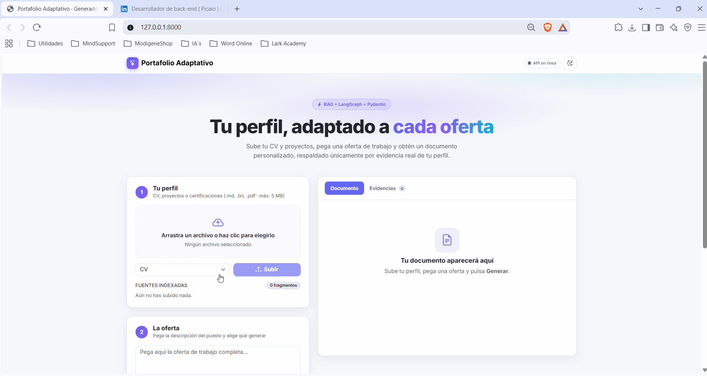
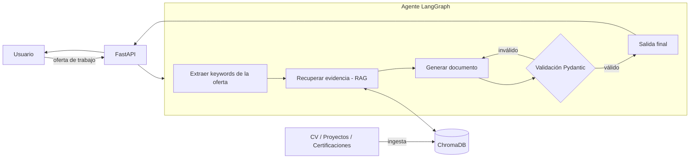

# 🎯 Agente de Portafolio Adaptativo y Preparador de Entrevistas

Agente de IA que, a partir de tu perfil profesional (CV, proyectos, certificaciones) y una oferta de trabajo, **genera documentos personalizados y validados**: CV adaptado, resumen de proyectos priorizados y borrador de carta de presentación. Después te ayuda a **practicar la entrevista técnica** con preguntas basadas en esa oferta y feedback contrastado con la evidencia de tu perfil.

<p align="center">
  
</p>

> Estado: ✅ versión local completa (fases 1–5) · ⏸️ despliegue público fuera del alcance actual

## ¿Qué problema resuelve?

Personalizar un CV y una carta para cada oferta es lento y repetitivo. Este sistema automatiza el proceso usando **solo evidencia real de tu perfil** (RAG), evitando alucinaciones y formatos inconsistentes mediante validación estricta con Pydantic.

## Funcionalidades

1. **Ingesta de perfil**: carga de CV, proyectos y certificaciones (Markdown, TXT o PDF) desde la interfaz; se fragmentan por encabezados, se vectorizan con Gemini y se guardan en ChromaDB (idempotente por archivo).
2. **Análisis de oferta**: el usuario pega la descripción del puesto; el LLM extrae habilidades, requisitos y palabras clave.
3. **Orquestación con LangGraph**: `analyze_job → retrieve → generate → validate`, con hasta 3 reintentos si la salida es inválida o cita evidencias inexistentes.
4. **Salidas validadas** (esquemas Pydantic), cada una con `evidence_ids` que apuntan a fragmentos reales de tu perfil:
   - CV adaptado a la oferta
   - Resumen de proyectos priorizados por relevancia
   - Borrador de carta de presentación
5. **Anti-alucinación**: si el perfil no respalda la oferta (similitud baja), el agente responde `insufficient_evidence` en lugar de inventar.
6. **Selector de modelo**: la interfaz lista hasta 10 modelos Gemini disponibles para tu API key (`GET /models`).
7. **Aviso de privacidad obligatorio**: sin aceptarlo, la interfaz queda bloqueada y la API responde 403.
8. **Preparador de entrevistas**: genera entre 5 y 10 preguntas (6 por defecto) a partir de la oferta y del documento generado, cubriendo categorías técnica, proyecto, conductual, encaje y carencias.
9. **Evaluación de respuestas**: cada respuesta se contrasta con la evidencia del perfil y se puntúa con cinco criterios (relevancia, alineación con la evidencia, especificidad, estructura y profundidad técnica). El feedback incluye fortalezas, carencias, afirmaciones no respaldadas y un esquema sugerido.
10. **Resumen de la práctica**: nota global y por categoría, fortalezas y carencias recurrentes, próximos pasos y preguntas pendientes.
11. **Privacidad de las respuestas**: las sesiones viven en memoria con TTL de 120 minutos y máximo de 100; el texto de las respuestas no se guarda en la base vectorial ni en los logs.
12. **Producción**: rate limiting (slowapi), logs JSON con `X-Request-ID`, errores claros (404/409/413/415/422/429/502/503) y mensaje amistoso cuando Gemini está saturado.

## Alcance del proyecto

La versión entregada es una aplicación funcional para ejecutarse **localmente**. Su alcance incluye cargar un perfil profesional, analizar una oferta, generar documentos personalizados respaldados por evidencias del perfil y practicar una entrevista técnica con feedback, además de la API, la interfaz web y las pruebas descritas en este README.

No incluye un servicio público multiusuario ni el despliegue en un proveedor cloud. Antes de publicar una demo habría que definir cómo aislar los perfiles de distintos usuarios y controlar el consumo de la API de Gemini. Por eso, los elementos de despliegue se consideran posibles mejoras futuras, no trabajo pendiente para usar la versión local.

## Interfaz web

Una sola página (Bootstrap 5 + JS vanilla, sin build) servida por FastAPI desde `app/static/`:

- Aviso de privacidad al entrar (hay que aceptarlo para usar la app).
- Subir/ingestar el perfil y gestionar las fuentes indexadas.
- Pegar la oferta, elegir el modelo de IA y el tipo de documento (CV, proyectos, carta).
- Ver el resultado junto con las evidencias del perfil usadas.
- Copiar o descargar el documento en Markdown.
- Practicar la entrevista desde la pestaña **Entrevista**, habilitada al generar un documento: elegir el número de preguntas, responder con progreso visual y recibir feedback y resumen.
- Modo claro/oscuro, estados de carga y mensajes de error claros.

## API

Todas las rutas salvo `/health` y `/models` exigen la cabecera `X-Privacy-Consent: 2`.

| Método | Ruta | Uso |
|---|---|---|
| `GET` | `/health` | Estado del servicio. |
| `GET` | `/models` | Modelos Gemini disponibles para la API key. |
| `POST` | `/ingest` | Indexar un archivo del perfil (`cv`, `project`, `certification`, `other`). |
| `GET` | `/sources` | Listar fuentes indexadas. |
| `DELETE` | `/sources/{name}` | Borrar una fuente y sus fragmentos. |
| `POST` | `/generate` | Generar CV, proyectos o carta; devuelve `evidence` usada y `retrieved_evidence` recuperada. |
| `POST` | `/interview/sessions` | Crear una sesión de entrevista (`question_count` 5–10; modelo opcional con `?model=`). |
| `POST` | `/interview/sessions/{id}/answers` | Evaluar una respuesta; una sola vez por pregunta. |
| `GET` | `/interview/sessions/{id}/summary` | Resumen agregado de la práctica. |
| `DELETE` | `/interview/sessions/{id}` | Terminar y borrar la sesión. |

Códigos de la entrevista: `404` sesión inexistente o expirada, `409` pregunta ya respondida, `422` entrada inválida (documento, evidencia, pregunta o respuesta) y `502` si el LLM no produce un plan o una evaluación válidos tras los reintentos.

## Arquitectura



La entrevista reutiliza ese contexto: `POST /interview/sessions` valida el documento y la evidencia, pide al LLM un plan con categorías obligatorias y `evidence_ids` reales, y guarda la sesión en memoria. Cada respuesta se evalúa contra el mismo material con cinco criterios; el servidor calcula la nota y el veredicto, y el resumen se agrega de forma determinista sin una llamada extra al LLM.

## Stack

| Capa | Tecnología |
|---|---|
| API | FastAPI |
| Frontend | JavaScript vanilla + Bootstrap 5 (servido como estáticos por FastAPI) |
| Agente | LangGraph |
| Vector DB | ChromaDB (o Qdrant) |
| Validación | Pydantic v2 |
| LLM | Google Gemini (capa gratuita, vía Google AI Studio) con `langchain-google-genai` |
| Embeddings | Gemini `gemini-embedding-001` (misma API key, capa gratuita) |
| Despliegue | Docker + Railway/Render/HF Spaces |
| Calidad | pytest, slowapi, logs estructurados |

## Estructura

```
agente-portafolio-adaptivo/
├── app/
│   ├── main.py            # FastAPI, middleware, errores, estáticos
│   ├── api/               # endpoints (health, models, ingest/sources, generate, interview)
│   ├── agent/             # grafo LangGraph, contexto compartido, prompts y LLM
│   ├── interview/         # sesiones en memoria, prompts, evaluación y resumen
│   ├── rag/               # carga, chunking, embeddings y ChromaDB
│   ├── schemas/           # modelos Pydantic
│   ├── static/            # frontend (index.html, app.js, styles.css)
│   └── core/              # config, logging, rate limit
├── scripts/               # list_models.py, evaluate.py, evaluate_interview.py
├── eval/                  # cases.json, interview_cases.json y reportes
├── data/profile/          # tu perfil en Markdown (ignorado por git)
├── chroma_db/             # índice vectorial local (ignorado por git)
└── tests/                 # 67 tests (sin red: LLM y embeddings falsos)
```

## Decisiones de diseño

- **¿Por qué LangGraph y no una cadena simple?** Flujo con estado, ramas condicionales (fallback sin evidencia) y reintentos por validación fallida.
- **¿Por qué Pydantic y no solo prompt engineering?** Garantiza salidas válidas y tipadas; permite reintentos automáticos con feedback del error.
- **¿Por qué RAG?** El documento solo puede afirmar lo que está respaldado por tu perfil, y cada afirmación cita sus `evidence_ids`.
- **¿Por qué un umbral de similitud?** Evita generar documentos para ofertas que no encajan. Se calibró con el set de evaluación (ver resultados abajo).
- **¿Por qué sesiones de entrevista en memoria y no en base de datos?** El texto de las respuestas es sensible y solo se necesita durante la práctica. Un TTL de 120 minutos y un máximo de 100 sesiones acotan el uso de memoria; al expirar o reiniciar el servidor, la sesión desaparece.
- **¿Por qué calcula la nota el servidor?** El LLM devuelve los cinco criterios (0–5) y el servidor aplica los pesos, la nota 0–100 y el veredicto. Así el resultado es reproducible y una inyección en la respuesta no puede inventarse la puntuación.
- **¿Por qué el resumen es determinista?** Se agregan las evaluaciones ya guardadas (medias por categoría, fortalezas y carencias recurrentes) sin otra llamada al LLM, lo que reduce coste y variabilidad.

## Instalación y uso

```bash
python -m venv .venv
.venv\Scripts\activate
pip install -r requirements.txt
copy .env.example .env   # y pega tu GOOGLE_API_KEY
uvicorn app.main:app --reload
```

Abre `http://localhost:8000`, acepta el aviso de privacidad y sube tus archivos de `data/profile/`.

Otros comandos:

```bash
pytest -q                                           # 67 tests, offline (~5 s)
python -m scripts.list_models                       # modelos Gemini disponibles
python -m scripts.evaluate --limit 3                # smoke de la evaluación de documentos
python -m scripts.evaluate_interview --limit 3      # smoke de la evaluación de entrevista
```

`scripts.evaluate` y `scripts.evaluate_interview` consumen cuota de Gemini y reescriben sus reportes completos en `eval/`, incluso con `--limit`. Los tests no llaman a la API real.

La API key se obtiene gratis en [Google AI Studio](https://aistudio.google.com/apikey). Nunca la subas al repositorio (`.env` está en `.gitignore`).

## Estado del desarrollo

Las fases previstas para la versión local están terminadas:

### Fase 1: cimientos del proyecto
- [x] Crear repositorio Git y `.gitignore` (excluir `.venv`, `.env`, `chroma_db/`)
- [x] Crear la estructura de carpetas propuesta
- [x] Crear `requirements.txt` / `pyproject.toml` con: `fastapi`, `uvicorn`, `langgraph`, `langchain`, `chromadb`, `pydantic`, `pydantic-settings`, `pytest`
- [x] Crear `.env.example` (API key del LLM, rutas) y `app/core/config.py`
- [x] Endpoint `GET /health` en FastAPI y primer test con pytest
- [x] Definir los esquemas Pydantic (`TailoredCV`, `ProjectSummary`, `CoverLetter`, `JobAnalysis`)

### Fase 2: RAG
- [x] Script de ingesta (carga md/txt/pdf + chunking por encabezados + embeddings Gemini + ChromaDB, idempotente por archivo)
- [x] Retriever con metadatos (tipo de documento: cv/project/certification/other)
- [x] Tests del RAG (embedder falso, sin red)

### Fase 3: Agente
- [x] Estado y nodos de LangGraph (`analyze_job` → `retrieve` → `generate` → `validate`) en `app/agent/`
- [x] Reintentos (máx. 3) ante salida inválida o `evidence_ids` inventados, con feedback al LLM
- [x] Fallback `insufficient_evidence` si el perfil no respalda la oferta
- [x] Tests del agente con LLM falso (sin red)

### Fase 4: API y calidad
- [x] Endpoints `POST /ingest`, `GET /sources`, `DELETE /sources/{name}` y `POST /generate`
- [x] Rate limiting (slowapi), logs JSON estructurados con `X-Request-ID`, manejo de errores (413/415/422/429/502/503)
- [x] Tests de endpoints (incluidos en los 67 tests actuales)
- [x] Set de evaluación de 20 ejemplos (`eval/cases.json`, 15 con encaje y 5 sin encaje) y script `python -m scripts.evaluate`
- [x] Umbral `MIN_TOP_SCORE` calibrado con la evaluación (las ofertas sin encaje pasaron de 0/5 a 5/5 rechazadas)

#### Resultados de evaluación

Modelo `gemini-3.1-flash-lite`, embeddings `gemini-embedding-001`. Reporte completo en `eval/report.md`.

| Métrica | Resultado |
|---|---|
| Recall@5 (evidencia esperada en el top 5) | 31/32 (97%) |
| Documento generado con éxito (ofertas con encaje) | 15/15 (100%) |
| Validación Pydantic al primer intento | 15/15 (100%) |
| Fidelidad (sin cifras inventadas) | 15/15 (100%) |
| Rechazos correctos (ofertas sin encaje) | 5/5 (100%) |
| Falsos rechazos (ofertas con encaje) | 0/15 (0%) |

> Limitaciones: el perfil es pequeño (16 fragmentos), así que Recall@5 es permisivo, y el umbral se calibró con los mismos 20 casos. Para comparar modelos: `python -m scripts.evaluate --model gemini-3.5-flash`.

### Fase 4b: Frontend
- [x] `app/static/index.html` con Bootstrap 5 (HTML, CSS y JS separados; modo claro/oscuro)
- [x] `app.js` con `fetch` a `/generate`, `/ingest` y `/sources`, estados de carga y errores
- [x] Mostrar evidencias usadas, copiar y descargar resultado (.md)
- [x] Montar `StaticFiles` en FastAPI (la UI se abre en `http://localhost:8000`)
- [x] Selector de modelo Gemini (`GET /models`, hasta 10 modelos; `python -m scripts.list_models` los lista por consola)
- [x] Aviso de privacidad obligatorio: sin aceptarlo la UI queda bloqueada y la API responde 403 (cabecera `X-Privacy-Consent: 2`)

### Fase 5: Preparador de entrevistas
- [x] Plan de 5–10 preguntas (6 por defecto) con categorías técnica, proyecto, conductual, encaje y carencias, validadas contra el documento y los `evidence_ids` reales
- [x] Evaluación de cada respuesta con cinco criterios, nota 0–100, veredicto y feedback (fortalezas, carencias, afirmaciones no respaldadas y esquema sugerido)
- [x] Sesiones en memoria con TTL, máximo de sesiones, una respuesta por pregunta y borrado explícito; el texto de la respuesta no se persiste ni se loguea
- [x] Endpoints `POST /interview/sessions`, `POST /interview/sessions/{id}/answers`, `GET /interview/sessions/{id}/summary` y `DELETE /interview/sessions/{id}`
- [x] Pestaña **Entrevista** en la interfaz, habilitada al generar un documento, con progreso, feedback y resumen
- [x] Tests de dominio y de API de la entrevista, offline con LLM falso (67 tests en total)
- [x] Set de 8 casos y script `python -m scripts.evaluate_interview` para medir plan, evaluación, evidencias y separación entre respuestas fuertes y débiles
- [x] Aviso de privacidad actualizado a la versión 2 para cubrir la evaluación de respuestas

## Posibles mejoras futuras

El despliegue público no forma parte de la versión completada y no está comprometido como siguiente fase. Si se decide publicar una demo, estos serían temas a evaluar:

- **Aislamiento y privacidad:** diseñar un modo demo que no exponga ni permita modificar perfiles de otros usuarios; revisar también el aviso de privacidad para ese uso.
- **Control de cuota:** limitar las generaciones globales además del rate limit por IP, o evaluar BYOK para que cada persona use su propia API key de Gemini.
- **Despliegue:** preparar Docker y elegir un proveedor, teniendo en cuenta la persistencia del índice vectorial y las limitaciones de los planes gratuitos.

## Licencia

MIT
