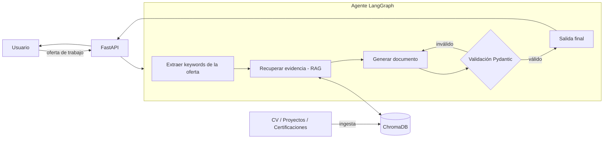

# 🎯 Agente de Portafolio Adaptativo y Generador de Documentos

Agente de IA que, a partir de tu perfil profesional (CV, proyectos, certificaciones) y una oferta de trabajo, **genera documentos personalizados y validados**: CV adaptado, resumen de proyectos priorizados y borrador de carta de presentación.

> Estado: 🚧 en desarrollo (fase de planificación)

## ¿Qué problema resuelve?

Personalizar un CV y una carta para cada oferta es lento y repetitivo. Este sistema automatiza el proceso usando **solo evidencia real de tu perfil** (RAG), evitando alucinaciones y formatos inconsistentes mediante validación estricta con Pydantic.

## Funcionalidades

1. **Ingesta de perfil**: carga de CV, proyectos y certificaciones (Markdown/PDF) en una base de datos vectorial.
2. **Análisis de oferta**: el usuario pega la descripción del puesto; se extraen habilidades, requisitos y palabras clave.
3. **Orquestación con LangGraph**: el agente planifica y ejecuta pasos con estado (extraer → recuperar evidencia → generar → validar → reintentar).
4. **Salidas validadas** (esquemas Pydantic):
   - CV adaptado a la oferta
   - Resumen de proyectos priorizados por relevancia
   - Borrador de carta de presentación

## Arquitectura



## Stack

| Capa | Tecnología |
|---|---|
| API | FastAPI |
| Agente | LangGraph |
| Vector DB | ChromaDB (o Qdrant) |
| Validación | Pydantic v2 |
| LLM | Por definir (OpenAI / Ollama) |
| Despliegue | Docker + Railway/Render/HF Spaces |
| Calidad | pytest, slowapi, logs estructurados |

## Estructura propuesta

```
agente-portafolio-adaptivo/
├── app/
│   ├── main.py            # FastAPI
│   ├── api/               # endpoints
│   ├── agent/             # grafo LangGraph (nodos, estado)
│   ├── rag/               # ingesta, embeddings, retriever
│   ├── schemas/           # modelos Pydantic
│   └── core/              # config, logging
├── data/profile/          # tu CV y proyectos en Markdown
├── tests/
├── eval/                  # set de evaluación (~20 ejemplos)
├── Dockerfile
├── docker-compose.yml
└── README.md
```

## Decisiones de diseño (a documentar)

- **¿Por qué LangGraph y no una cadena simple?** Flujo con estado, ramas condicionales y reintentos por validación fallida.
- **¿Por qué Pydantic y no solo prompt engineering?** Garantiza salidas válidas y tipadas; permite reintentos automáticos.
- **¿Por qué RAG?** El documento solo puede afirmar lo que está respaldado por tu perfil.

## Instalación (próximamente)

```bash
python -m venv .venv
.venv\Scripts\activate
pip install -r requirements.txt
uvicorn app.main:app --reload
```

## 🚀 Próximos pasos

### Primer paso (ahora): cimientos del proyecto
- [ ] Crear repositorio Git y `.gitignore` (excluir `.venv`, `.env`, `chroma_db/`)
- [ ] Crear la estructura de carpetas propuesta
- [ ] Crear `requirements.txt` / `pyproject.toml` con: `fastapi`, `uvicorn`, `langgraph`, `langchain`, `chromadb`, `pydantic`, `pydantic-settings`, `pytest`
- [ ] Crear `.env.example` (API key del LLM, rutas) y `app/core/config.py`
- [ ] Endpoint `GET /health` en FastAPI y primer test con pytest
- [ ] Redactar tu perfil en `data/profile/` (CV, proyectos, certificaciones en Markdown) con datos **reales**
- [ ] Definir los esquemas Pydantic (`TailoredCV`, `ProjectSummary`, `CoverLetter`, `JobAnalysis`)

### Fase 2: RAG
- [ ] Script de ingesta (chunking + embeddings + ChromaDB)
- [ ] Retriever con metadatos (tipo de documento, fecha)

### Fase 3: Agente
- [ ] Estado y nodos de LangGraph (extraer keywords, recuperar, generar, validar)
- [ ] Reintentos ante validación fallida y fallback si no hay evidencia suficiente

### Fase 4: API y calidad
- [ ] Endpoints `/ingest` y `/generate`
- [ ] Rate limiting (slowapi), logs estructurados, manejo de errores
- [ ] Tests de endpoints + set de evaluación de ~20 ejemplos

### Fase 5: Despliegue y presentación
- [ ] Dockerfile y docker-compose
- [ ] Deploy en Railway/Render/HF Spaces con enlace público
- [ ] Completar README: diagrama final, métricas de evaluación, demo (GIF)
- [ ] Añadir al CV: *"Desarrollé un agente de IA con FastAPI y LangGraph que genera CVs y resúmenes de proyectos adaptados a ofertas de trabajo, usando RAG sobre mi portafolio y validación estricta con Pydantic."*

## Licencia

MIT
